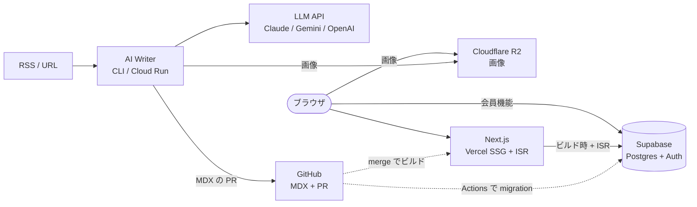

Revolution は、LLM (Claude / OpenAI / Gemini) を活用した **AI 記事生成パイプライン** と、生成された記事を **MDX ファイル** として GitHub に PR で投入し、Next.js の SSG + ISR で配信する Jamstack 構成の Web メディアシステムです。記事以外の構造化データと会員機能は **Supabase** に置いています。

## ビジョン

これまで手動で 1 万記事以上を作成してきた知見を、LLM とモジュール化された YAML テンプレートに落とし込み、**RSS / URL → N ステップのパイプライン → MDX → GitHub PR → 公開** までを自動化する。

## システム全体像

実線は同期のリクエスト、破線はイベントで動く処理。パイプラインの概要は [`apps/ai-writer/README.md`](../apps/ai-writer/README.md) を参照。

## 構成要素

| 領域 | 役割 | 詳細 |
|---|---|---|
| **AI Writer** (`apps/ai-writer/`) | パイプライン本体。LLM 呼び出し / テンプレート展開 / Schema 検証 / MDX 生成 / PR 作成と、管理画面。手元の CLI と Cloud Run で動く | [`apps/ai-writer/README.md`](../apps/ai-writer/README.md) |
| **Frontend** (`apps/frontend/`) | 公開 Web サイトと会員機能 (Next.js 16、SSG + ISR)。Vercel で配信 | [`current-stack.md`](./current-stack.md) |
| **Docs site** (`apps/docs/`) | `docs/` 直下のドキュメントを配信 (Fumadocs)。Vercel で配信し、検索エンジンには載せない | [`README.md`](./README.md) |
| **Supabase** | 構造化データと会員機能 (Postgres + Auth + RLS)。production / staging の 2 プロジェクト。migration は `apps/frontend/supabase/migrations/` | [`current-stack.md`](./current-stack.md) |
| **Firebase** (Auth + Firestore) | AI Writer の管理画面の認証と、RSS フィードの登録・重複判定などパイプラインの状態 | — |
| **Cloudflare R2** | 記事の画像の保管と配信 | — |
| **Templates** (別リポジトリ `revolution-templates`) | YAML テンプレート集。プロンプト + 出力スキーマ | (private) |
| **Cloud Run** | AI Writer のサーバーレス実行環境 (Cloud Scheduler による定期起動は未設定。[`sentry.md`](./sentry.md)) | [`ai-writer-cloud-run.md`](./ai-writer-cloud-run.md) |
| **GitHub** | MDX ソース管理 + PR ベース公開ワークフロー。Actions で CI / Cloud Run のデプロイ / Supabase の migration / 通知 | [`build.md`](./build.md) |
| **Sentry / Slack** | エラー監視と通知 | [`sentry.md`](./sentry.md) / [`slack-notifications.md`](./slack-notifications.md) |

## 設計原則

- **Schema-SDD** (Schema-Driven Development): `shared/schemas/` の Zod スキーマ (と `shared/schemas/db/` の Drizzle のテーブル定義) が真実源。すべての入出力境界で検証
- **層別 TDD** (5 層モデル): 純粋関数 (Layer 1) と外部との境界の contract test (Layer 2) を MUST、パイプラインの snapshot (Layer 3)・AI 出力の品質 (Layer 4)・Frontend の E2E (Layer 5) は段階的に導入
- **SoC** (Separation of Concerns): AI Writer (記事生成) と Frontend (表示) は責務分離。AI Writer は Frontend の知識を持たない

詳細: `@llm-context/development-principles.md` (gitignored、Claude セッション内で自動ロード)

## 利用者像

- **個人開発者** ([@thanks2music](https://github.com/thanks2music)): 知見を AI で省力化しつつ品質を担保
- **AI コラボレーター** (Claude Code / Codex / ChatGPT): スキーマと llm-context により迷わずコード変更
